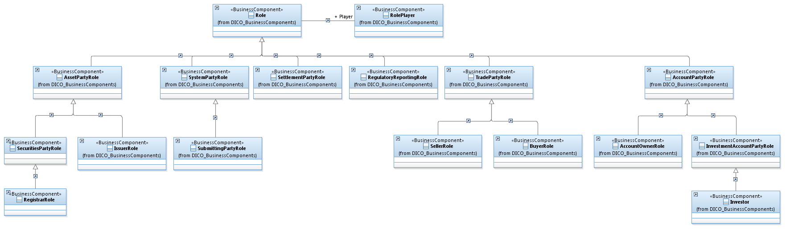

# Project references

The repository contains the following original artifacts. They remain canonical in
Git rather than being converted or copied into competing Markdown specifications:

- [UMLprofile.doc](https://github.com/chris-day/iso20022-ecore/blob/main/UMLprofile.doc): ISO 20022 UML profile reference, in legacy Microsoft Word format.
- [XMLSchemaGeneration.doc](https://github.com/chris-day/iso20022-ecore/blob/main/XMLSchemaGeneration.doc): XML schema generation rules, in legacy Microsoft Word format.
- [auth.016.001.03.xsd](https://github.com/chris-day/iso20022-ecore/blob/main/auth.016.001.03.xsd): example XML schema used by enrichment examples.
- [LICENSE](https://github.com/chris-day/iso20022-ecore/blob/main/LICENSE): canonical root license text. The GPL-3.0 text conflicts with the MIT declaration in package metadata; maintainers must resolve that existing inconsistency.

The Word files retain their original attribution and notices. This migration does
not reinterpret their specification text or grant additional redistribution rights.

## BusinessComponent visualization

The existing repository illustration is preserved below. This is a conceptual
example, not an automatically generated view of the current resource file.

## Input files

The metamodel and full repository resource are external inputs, not bundled data.
Paths such as `/var/software/input/ISO20022.ecore` in examples are illustrative local
file locations; replace them with your own paths. They are not published URLs.
