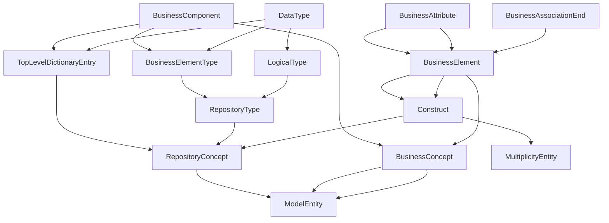

# Pruning & Dry-Run

Pruning lets you keep or remove classes before exporting a new instance file.

## Example: Conceptual pruning

This example keeps only conceptual Business* classes and DataType, expands the exact class include set with supertypes, and serializes default values (e.g.,
`registrationStatus="Provisionally Registered"`). It also strips references to
pruned classes and logs attribute defaults.

```bash
emf-read \
  --ecore /var/software/input/ISO20022.ecore \
  --instance /var/software/input/20250424_ISO20022_2013_eRepository.iso20022 \
  --export-instance /tmp/iso20022_conceptual_pruned.iso20022.xml \
  --include-classes BusinessComponent,BusinessElement,BusinessAssociationEnd,BusinessAssociation,BusinessAttribute,DataType \
  --prune-include-supertypes \
  --prune-serialize-defaults \
  --prune-strip-refs \
  --prune-drop-refs associationDomain \
  --prune-debug-attrs
```

### What you specify vs what gets included

The include list (what you specify):


With `--prune-include-supertypes`, these supertypes expand the include set.
Inherited attributes are already available on concrete instances through the loaded metamodel:



Notes:

- `--prune-serialize-defaults` forces default values (including enum defaults) to appear in the output.
- `--prune-strip-refs` removes references to pruned objects to keep the result consistent.
- The output keeps the containment chain (Repository → DataDictionary → TopLevelDictionaryEntry) by default.

## Omitting named references

Export the conceptual resource while omitting `associationDomain`:

```bash
emf-read \
  --ecore /var/software/input/ISO20022.ecore \
  --instance /var/software/input/20250424_ISO20022_2013_eRepository.iso20022 \
  --export-instance /tmp/iso20022_conceptual_pruned.iso20022.xml \
  --include-classes BusinessComponent,BusinessElement,BusinessAssociationEnd,BusinessAssociation,BusinessAttribute,DataType \
  --prune-include-supertypes \
  --prune-serialize-defaults \
  --prune-strip-refs \
  --prune-drop-refs associationDomain
```

`--prune-drop-refs` accepts comma-separated non-containment reference names,
matched on every exported object's class (including inherited references).
It omits those features from XMI even when their targets are retained, without
writing `xsi:nil` placeholders. `BusinessAssociationEnd` objects and their `type`
references remain. Unlike `--prune-strip-refs`, this option selects references
by name rather than by whether their target was pruned. Containment reference
names are not supported. Reloading XMI may reconstruct omitted inverse references
from their retained opposites; this is an export presentation option.

## Dry-run (metamodel only)

```bash
emf-read \
  --ecore /var/software/input/ISO20022.ecore \
  --include-classes BusinessComponent,BusinessAssociationEnd \
  --exclude-classes BusinessProcess \
  --prune-dry-run \
  --prune-dry-run-json /tmp/prune_preview.json
```

Dry-run reports:

- selected/pruned classes
- pruned containment features
- pruned reference features

Use `--prune-include-supertypes` to expand the class include set upward. It does not include subclasses of `DataType`.
Use `--prune-no-containers` to disable including containment ancestors (by default,
the export keeps the containment chain to ensure a valid root structure).

## Export filtered instance

```bash
emf-read \
  --ecore /var/software/input/ISO20022.ecore \
  --instance /var/software/input/20250424_ISO20022_2013_eRepository.iso20022 \
  --export-instance /tmp/filtered.iso20022 \
  --include-classes BusinessComponent,BusinessAssociationEnd \
  --exclude-classes BusinessProcess \
  --prune-include-supertypes \
  --prune-strip-refs \
  --prune-serialize-defaults
```

## Implementation limits

Class selection uses exact EClass names; exclusions take precedence during selection.
Abstract types such as `DataType` do not select instances of concrete subclasses such
as `Amount` or `Text`. List the desired concrete types explicitly. The supplied
ISO20022.ecore does not declare `BusinessAssociation`; the historical example retains
that requested name for context, but it selects no instances in this metamodel.

Containment ancestors are retained by default, even when their classes were excluded,
to preserve the ownership path. `Repository` and `DataDictionary` are containers,
not supertypes of `BusinessComponent`. Including containers alone does not prune
their other children: use `--prune-strip-refs` for this example.

The current exporter moves objects into a new resource and temporarily changes
references. Use a fresh ResourceSet for each export in library code. It does not
promise a non-mutating clone or enforce metamodel lower bounds after pruning.
Structural previews report selected-to-pruned feature types, not an exact prediction
of serialized instance edges. The metamodel helper currently inspects the EClass
metaclass for inherited references/supertypes, so those preview and expansion results
need independent inspection. Metamodel graph exporters use the same helper.

Default serialization uses `XMIOptions.SERIALIZE_DEFAULT_VALUES`; explicitly set
`None` references may appear as `xsi:nil`. There are legacy enum conversion and
`_isset` compatibility paths in the exporter. A default must never be assumed to
recover an original registration status lost during loading. Inspect source values
before relying on pruned output for registration metadata. This migration changes
documentation, not the application's enum or pruning implementation.
